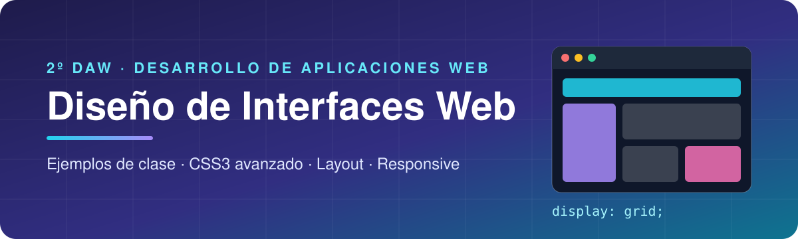
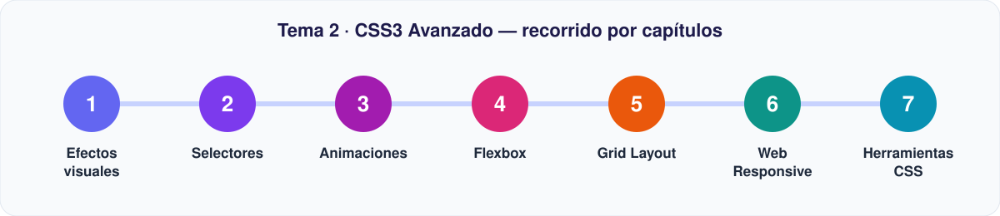

<p align="center">
  
</p>

<p align="center">
  
  
  
  
  
  
</p>

# 🎨 Diseño de Interfaces Web · 2º DAW

Repositorio del módulo **Diseño de Interfaces Web (DIW)** del ciclo formativo de grado superior **Desarrollo de Aplicaciones Web**.

Aquí encontrarás, organizados por capítulos, **los ejemplos que vemos en clase**, la teoría en PDF y los ejercicios para practicar. Cada ejemplo es autónomo: puedes verlo directamente en el navegador o descargarlo y abrir su `index.html`.

> 🌐 **Ver los ejemplos en vivo:** https://TU_USUARIO.github.io/diw-2daw/

---

## 🎯 Objetivos del módulo

- Planificar y diseñar interfaces web atendiendo a criterios de **usabilidad** y **accesibilidad**.
- Dominar **CSS3 avanzado**: selectores, efectos visuales, transiciones y animaciones.
- Maquetar con los sistemas de layout modernos: **Flexbox** y **CSS Grid**.
- Crear sitios **responsive** que se adapten a cualquier dispositivo.
- Conocer y usar **herramientas** que agilizan el trabajo con CSS.

---

## 🗺️ Contenidos

<p align="center">
  
</p>

### Tema 2 · CSS3 Avanzado

| Cap. | Contenido | Qué aprenderás | Carpeta |
|:---:|---|---|:---:|
| 1 | ✨ **Efectos visuales** | Sombras, degradados, bordes redondeados, transformaciones y filtros | [📂](T02-css3-avanzado/C01-efectos-visuales/) |
| 2 | 🎯 **Selectores** | Selectores de atributo, combinadores, pseudoclases y pseudoelementos | [📂](T02-css3-avanzado/C02-selectores/) |
| 3 | 🎬 **Animaciones** | Transiciones, `@keyframes` y propiedades de animación | [📂](T02-css3-avanzado/C03-animaciones/) |
| 4 | 📦 **Flexbox** | Contenedores y elementos flexibles, alineación y distribución | [📂](T02-css3-avanzado/C04-flexbox/) |
| 5 | 🔲 **Grid Layout** | Rejillas, áreas, líneas y diseño bidimensional | [📂](T02-css3-avanzado/C05-grid-layout/) |
| 6 | 📱 **Web Responsive** | Viewport, media queries, unidades relativas e imágenes adaptables | [📂](T02-css3-avanzado/C06-web-responsive/) |
| 7 | 🛠️ **Herramientas CSS** | Herramientas y recursos para trabajar con CSS de forma profesional | [📂](T02-css3-avanzado/C07-herramientas-css/) |
| — | 📝 **Ejercicios** | Ejercicios de repaso de todo el tema | [📂](T02-css3-avanzado/ejercicios/) |

---

## 📁 Estructura del repositorio

```
diw-2daw/
├── README.md
├── recursos/                     ← Imágenes y material común
├── T02-css3-avanzado/
│   ├── C01-efectos-visuales/
│   │   ├── README.md             ← Índice de ejemplos del capítulo
│   │   ├── teoria/               ← Apuntes en PDF
│   │   └── ejemplos/
│   │       └── 01-nombre-ejemplo/
│   │           ├── index.html
│   │           ├── css/
│   │           └── img/
│   ├── C02-selectores/
│   ├── ...
│   └── ejercicios/
└── extra/                        ← Material complementario
```

---

## 🚀 Cómo usar este repositorio

**Opción 1 · Verlo en el navegador**
Entra en la web de GitHub Pages del repositorio y navega hasta el ejemplo que quieras.

**Opción 2 · Descargarlo todo**
Pulsa el botón verde **`<> Code` → `Download ZIP`**.

**Opción 3 · Clonarlo con Git** *(recomendado)*

```bash
git clone https://github.com/TU_USUARIO/diw-2daw.git
cd diw-2daw
```

Para traer los ejemplos nuevos que se vayan subiendo durante el curso:

```bash
git pull
```

---

## 🧰 Herramientas recomendadas

| Herramienta | Para qué |
|---|---|
| [Visual Studio Code](https://code.visualstudio.com/) | Editor de código |
| Extensión **Live Server** | Ver los cambios en el navegador al guardar |
| DevTools del navegador (`F12`) | Inspeccionar y probar CSS en directo |
| [MDN Web Docs](https://developer.mozilla.org/es/docs/Web/CSS) | Referencia de CSS |
| [Can I use](https://caniuse.com/) | Compatibilidad de propiedades entre navegadores |

---

## 👩‍🏫 Profesorado

**TU NOMBRE** · Módulo de Diseño de Interfaces Web
📧 tu.correo@centro.es · 🏫 Nombre del centro

---

## 📄 Licencia

Los materiales de este repositorio se distribuyen bajo licencia
[Creative Commons BY-NC-SA 4.0](https://creativecommons.org/licenses/by-nc-sa/4.0/deed.es): puedes usarlos y adaptarlos citando la autoría, sin fines comerciales y compartiendo bajo la misma licencia.

<p align="center">
  
</p>
